# Resources Describing the Construction of the Linn Cove Viaduct

* [YouTube Video](https://www.youtube.com/watch?v=iutJ6K1d2iQ) driving along the finished bridge and parkway

From the pictures, I see a tetrahedral shape comprised of 3 (yellow) bars mounted on a rigid (brown) structure, which is in turn mounted on a mobile base so that it can be made level using hydraulic jacks.
* The apex of the tetrahedron is the attachment point for:
    * the support cables running to the top of the boom
    * diagonal bars to the rotating ring (boom bottom pivot)
* The 2 outer bars are the "stiff legs".
* The third bar is vertical and defines the rotational swing axis of the crane. A circular wheel (hub-spokes-ring) is rotatably mounted at the bottom of this vertical bar. The main boom is pivotally mounted on this ring. Spokes from the hub and diagonal bars from the apex of the tetrahedron carry the loads of the boom.
    * This implies that the diagonal bars must rotate with the wheel. The wheel is likely integrated with a tube surrounding the vertical leg of the tetrahedron and it needs a top bearing to support radial loads from the diagonal bars.
     
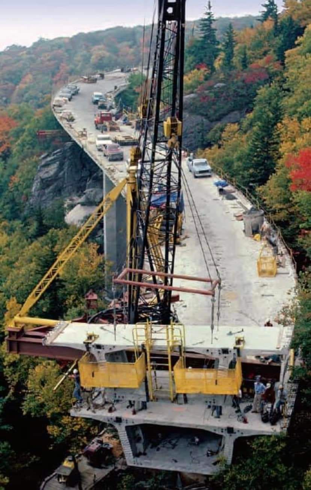
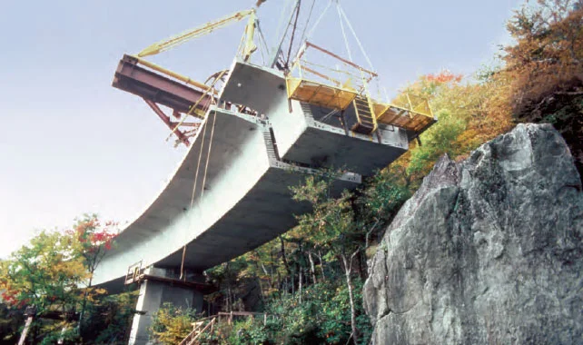
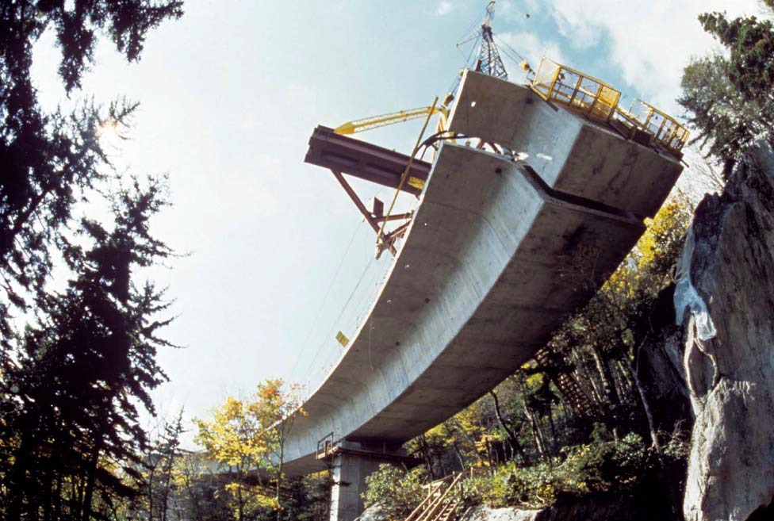
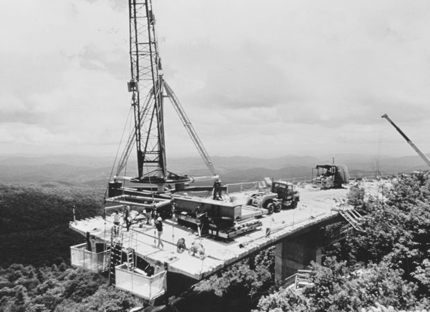

 [Wikipedia](https://en.wikipedia.org/wiki/Linn_Cove_Viaduct)

* [History of the Linn Cove Viaduct](https://www.nps.gov/blri/learn/historyculture/linn-cove-viaduct.htm)
* [Historic American Engineering Record (HAER No. NC-42-A)](https://tile.loc.gov/storage-services/master/pnp/habshaer/nc/nc0400/nc0483/data/nc0483data.pdf)
* [NPS Data Store Reference](https://irmadev.nps.gov/DataStore/Reference/Profile/2265973) (Dead end)
* [Construction Practices Handbook (for Concrete Segmental and Cable-Supported Bridges)](https://asbi-assoc.org/wp-content/uploads/2023/07/2019-3rd_Edition_CP_Handbook.pdf)

Claude provided the following links:

1. The contract plan sheets (the drawings you want). Florida International University runs a database of accelerated bridge construction projects for FHWA, and its Linn Cove entry has Contract Plans: View linncove.pdf. Its summary sheet describes this as Bridge Plan Sheets (link to pdf). The page wouldn’t give me the link’s address, so open the [project page](https://utcdb.fiu.edu/project/1983-linn-cove-viaduct/) and click it:
    * [Plan and Elevation views of roadway, piers, and footers](https://utcdb.fiu.edu/wp-content/uploads/2021/09/linncove.pdf)
2. [Design and Construction of Linn Cove Viaduct](https://www.pci.org/PCI_Docs/Publications/PCI%20Journal/1985/September-1985/Design%20and%20Construction%20of%20Linn%20Cover%20Viaduct.pdf)

Claude wasn't able to open the Plan Sheets for the viaduct,  but offered to generate a STEP file for the bridge based on them so I sent him the pdf and he generated a step model.

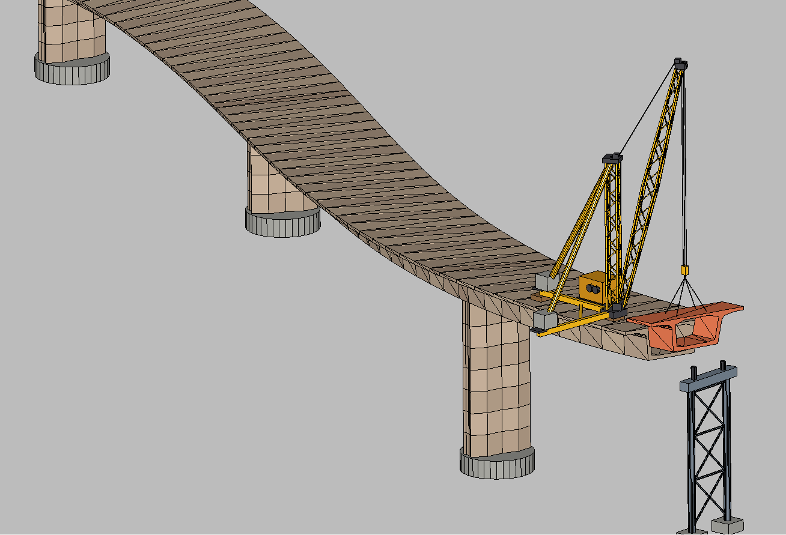

Claude's model of the American S-20 Crane above gives the idea of a crane, but I decided to try to improve on it. This was motivated partly by a desire to have it be more realistic and partly as a CAD challenge to exercise KodaCAD (at version 2.3.0). The process exposed some needed improvements which were implemented in version 2.4.0. KodaCAD was able to do the job, but it was tedious to use (in comparison to a full-fledged professional CAD app like SolidDesigner).

The picture below shows the 2 cranes. Note that the newer version shows the bottom of the boom located at the rim of the bullwheel whereas the original shows it at the base of the mast, with the result that the boom must be more nearly vertical.

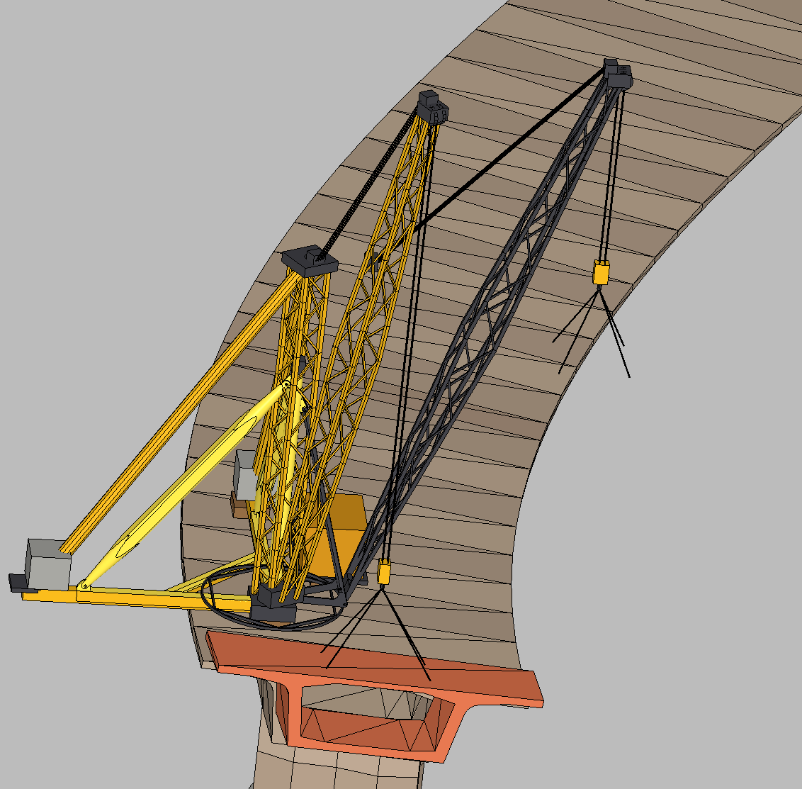

Dimensions of the crane were hard to find. Scouring the web, I only found some [overall dimensions](https://cranenetwork.com/uploads/specs/874bcb947ac5f70973963c6ca.pdf), but for details, I had to rely on scaling some grainy photos. Eventually, I ended up converging on an improved model that showed my guess at the configuration of the moving components, with roughly correct overall dimensions. An additional detail was the need for the crane to be supported on a frame which, in turn, needed to be supported on 3 adjustable blocks. This allowed the mast to always be vertical, as the *superelevation* of the roadway surface below it was variable from one location to another. The details are still all fudged to the point where they pass as "eye-wash". This is where I decided that I had chased this far enough. The view below shows the redesigned crane sitting on the *lofted* version of the roadway (up to segment 64).

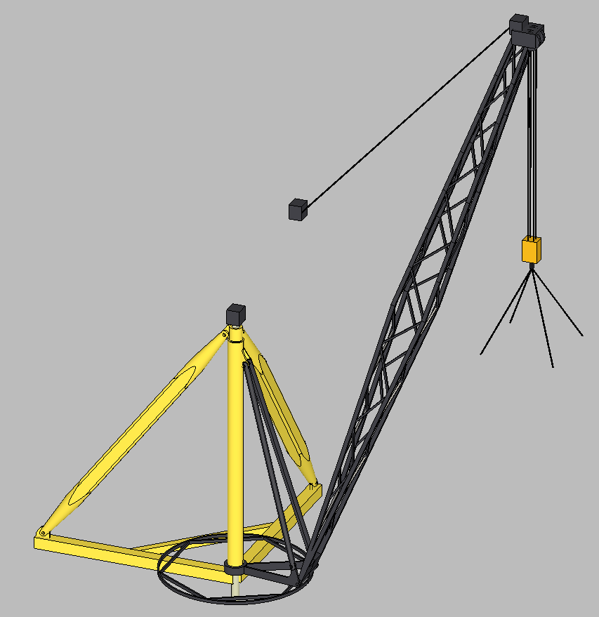

The series of pictures below captures the way section 65 would be picked up, lifted, swung by the crane, then lowered into position for installation.

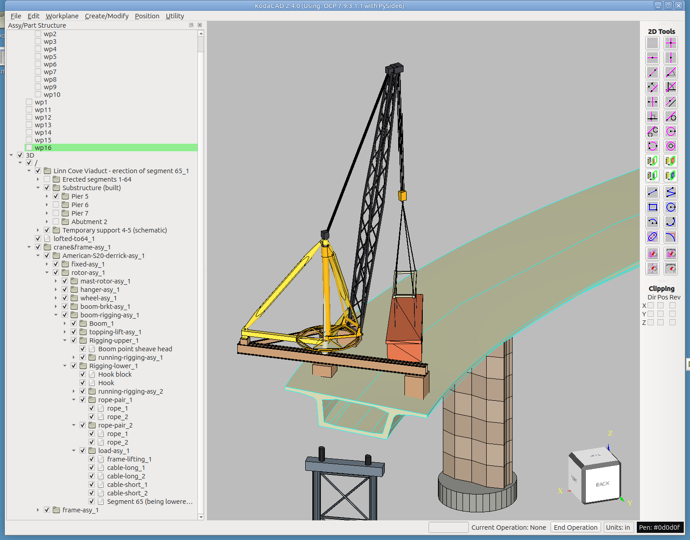

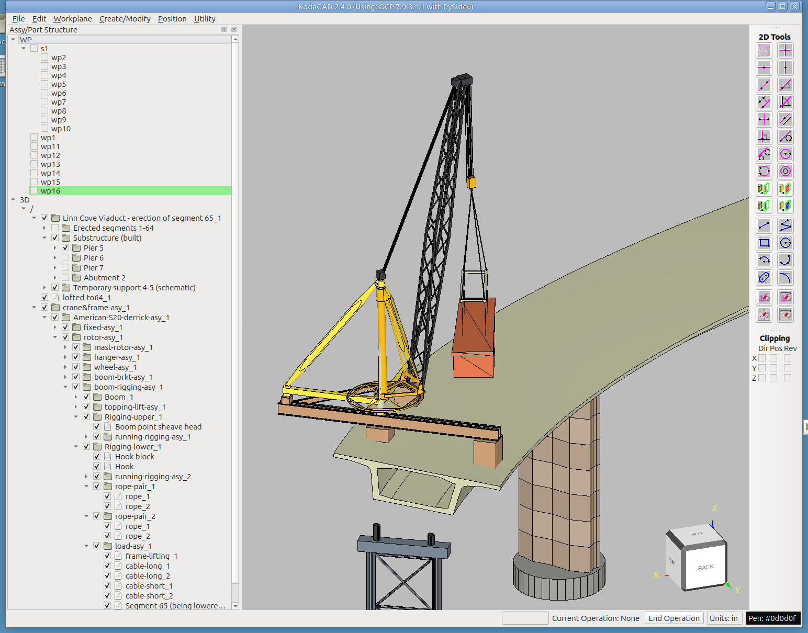

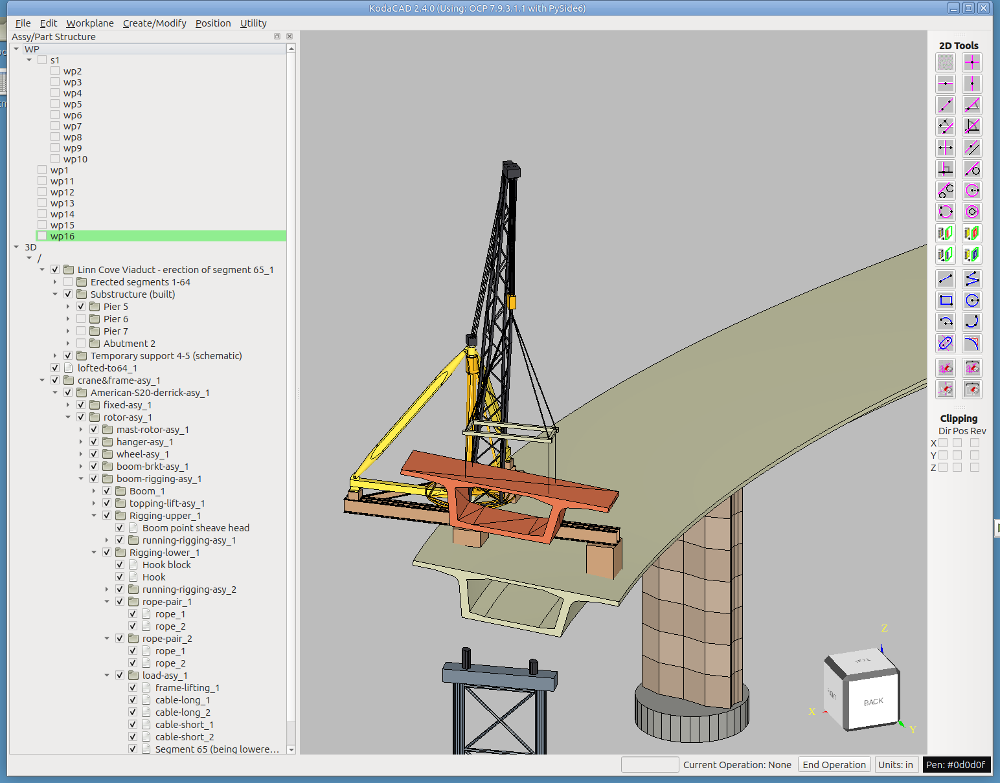

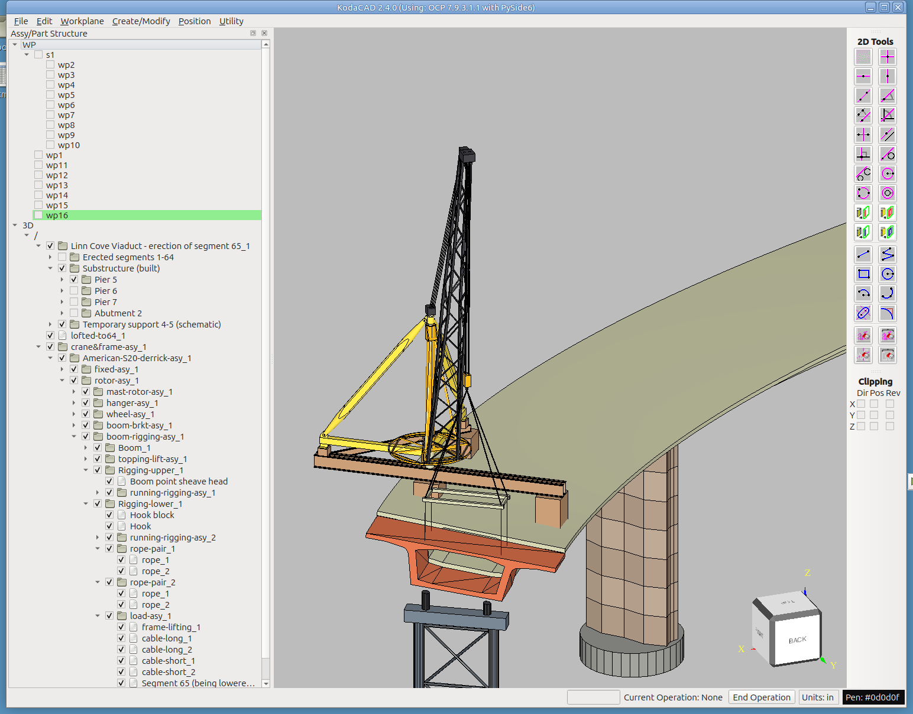

https://github.com/user-attachments/assets/3483cfc1-b80b-4bf8-a623-d6e395b24665

