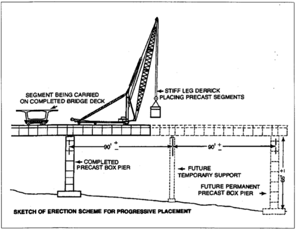

# Resources Describing the Construction of the Linn Cove Viaduct

* [YouTube Video](https://www.youtube.com/watch?v=iutJ6K1d2iQ) driving along the finished bridge and parkway

From the pictures, I see a tetrahedal shape comprised of 3 (yellow) bars mounted on a rigid (brown) structure, which is in turn mounted on a mobile base so that it can be made level using hydraulic jacks.
* The apex of the tetrahedron is the attachment point for:
    * the support cables running to the top of the boom
    * diagonal bars to the rotating ring (boom bottom pivot)
* The 2 outer bars are the "stiff legs".
* The third bar is vertical and defines the rotational swing axis of the crane. A circular wheel (hub-spokes-ring) is rotatably mounted at the bottom of this vertical bar. The main boom is pivotally mounted on this ring. Spokes from the hub and diagonal bars from the apex of the tetrahedron carry the loads of the boom.
    * This implies that the diagonal bars must rotate with the wheel. The wheel is likely integrated with a tube surrounding the vertical leg of the tetrahedron and it needs a top bearing to support radial loads from the diagonal bars.
     

 [Wikipedia](https://en.wikipedia.org/wiki/Linn_Cove_Viaduct)

* [History of the Linn Cove Viaduct](https://www.nps.gov/blri/learn/historyculture/linn-cove-viaduct.htm)
* [Historic American Engineering Record (HAER No. NC-42-A)](https://tile.loc.gov/storage-services/master/pnp/habshaer/nc/nc0400/nc0483/data/nc0483data.pdf)
* [NPS Data Store Reference](https://irmadev.nps.gov/DataStore/Reference/Profile/2265973) (Dead end)

Claude provided the following links:

1. The contract plan sheets (the drawings you want). Florida International University runs a database of accelerated bridge construction projects for FHWA, and its Linn Cove entry has Contract Plans: View linncove.pdf. Its summary sheet describes this as Bridge Plan Sheets (link to pdf). The page wouldn’t give me the link’s address, so open the [project page](https://utcdb.fiu.edu/project/1983-linn-cove-viaduct/) and click it:
    * [Plan and Elevation views of roadway, piers, and footers](https://utcdb.fiu.edu/wp-content/uploads/2021/09/linncove.pdf)
2. [Design and Construction of Linn Cove Viaduct](https://www.pci.org/PCI_Docs/Publications/PCI%20Journal/1985/September-1985/Design%20and%20Construction%20of%20Linn%20Cover%20Viaduct.pdf)

Claude wasn't able to open the Plan Sheets for the viaduct,  but offered to generate a STEP file for the bridge based on them so I sent him the pdf and he gernerated a step model.

